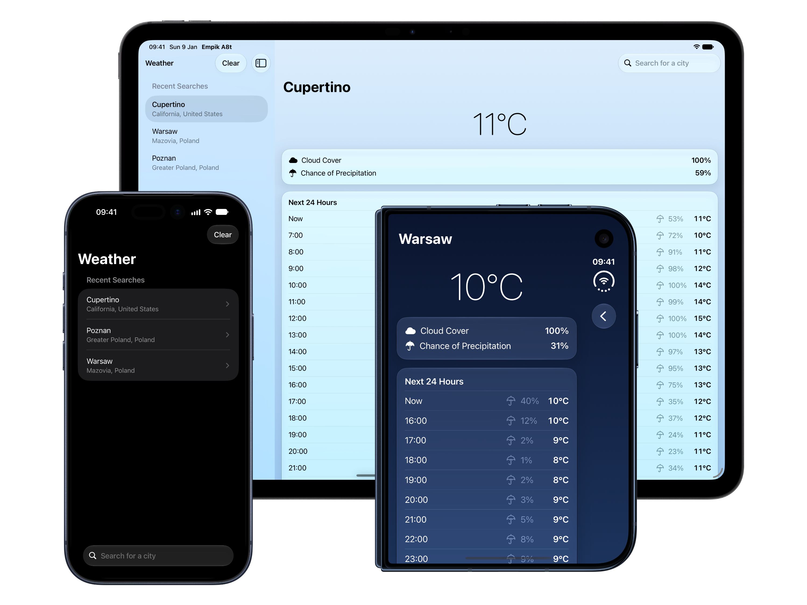
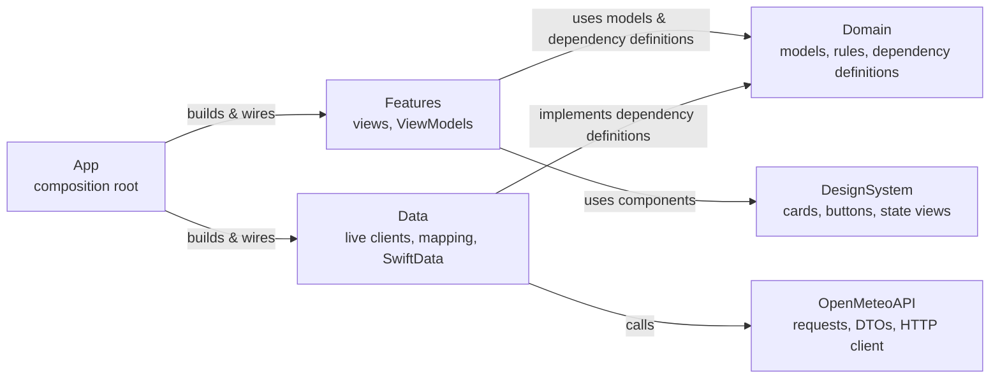
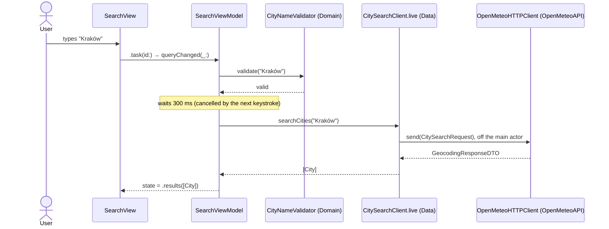
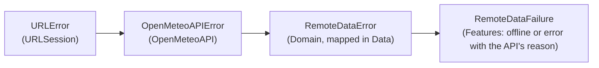

# Empik A8t

A weather app written in SwiftUI. Search for a city, pick it from the results or from your search history, and see
its current weather and the forecast for the next 24 hours. Data comes from [Open-Meteo](https://open-meteo.com),
which needs no API key.

Runs on iPhone, iPhone Duo and iPad with iOS 17 or later, supports Dark Mode, and is available in English and Polish.



## Requirements

| Requirement | How it is met |
|---|---|
| City name validation: no digits, no special characters except hyphen and space, Polish characters | [`CityNameValidator`](EmpikAssignment/Domain/CityNameValidation/CityNameValidator.swift) accepts letters from any alphabet, spaces and hyphens, and explains every rejected name with a specific message. |
| Search results in a list | Search as you type: 300 ms debounce, from 2 characters. |
| Search history kept between launches | SwiftData store. A city is saved when you pick it; newest first, no duplicates, swipe to delete, "Clear" with confirmation. |
| Forecast details after selecting a city | Current temperature, cloud cover, chance of precipitation, and the next 24 hours (time, chance of precipitation, temperature), shown in the city's time zone. |
| Loading, no internet connection, empty search result, API errors | Every screen state is a case of its ViewModel's state enum. "No connection" and API errors (with the reason returned by the API) have separate views with a "Try again" button. |
| Dark Mode | System semantic colors, plus own colors with light and dark variants. |
| iOS 17 or later | Deployment target 17.0. Newer APIs (Liquid Glass) are behind `#available` with iOS 17 fallbacks. Tests pass on iOS 17.0 and on the latest iOS. |
| Xcode 26 or Xcode 27 | The project file uses the format both versions open. |
| Optional: forecast for the next days | Not included, see [Deliberate scope](#deliberate-scope-and-how-to-extend). |

## Getting started

1. Clone the repository and open `EmpikAssignment.xcodeproj` in Xcode 26 or 27.
2. Run the `EmpikAssignment` scheme on an iOS 17+ simulator or device. No API key or extra setup is needed.

Run the unit tests:

```bash
xcodebuild -project EmpikAssignment.xcodeproj -scheme EmpikAssignment \
  -destination 'platform=iOS Simulator,name=<simulator name>' test
```

API base URLs live in [`Configuration/Debug.xcconfig`](Configuration/Debug.xcconfig) and
[`Configuration/Release.xcconfig`](Configuration/Release.xcconfig) and reach the app through `Info.plist`, so CI can
override them without code changes. Missing or empty values stop the app at launch with a clear message.

## Architecture

### Layers and dependencies



Dependencies point inward (the dependency rule of Clean Architecture): Domain depends
on nothing, Data implements what Domain defines, and App is the composition root that wires everything.

| Layer | Responsibility | May use |
|---|---|---|
| **Domain** | Models (`City`, `Forecast`, `SearchHistory`), business rules (name validation, history order) and dependency definitions | Foundation only |
| **OpenMeteoAPI** | Requests, response DTOs, HTTP client, API errors | Foundation only, no domain types |
| **Data** | Live implementations of the Domain dependencies: calls the API, maps DTOs to domain models, stores history with SwiftData | Domain, OpenMeteoAPI |
| **DesignSystem** | Reusable UI: cards, buttons, state views, colors, typography, animations | SwiftUI |
| **Features** | Screens, their subviews and ViewModels (`Search`, `Forecast`) | Domain, DesignSystem |
| **App** | Entry point, configuration, composition root, root navigation | Everything |

Each layer works only with its own types: DTOs and SwiftData models never leave Data, domain models cross into
Features, and view state stays in ViewModels. Only App reads the environment (`Bundle`, `Locale`, `URLSession`) and
passes values on as parameters or closures. The top-level folders are ready to become Swift packages.

### Dependencies and ViewModels

**Dependencies are protocol witnesses**: structs of closures defined in Domain, e.g.
[`CitySearchClient`](EmpikAssignment/Domain/City/CitySearchClient.swift), with live implementations in Data
(`CitySearchClient.live(…)`). [`CompositionRoot`](EmpikAssignment/App/CompositionRoot.swift) is the only place that
builds them. Tests and previews pass their own closures, so no mocking framework is needed.

**ViewModels** are `@Observable` and keep one state enum. Every change goes through a method, one per user action:

```swift
enum State { case loading, loaded(Forecast), failed(RemoteDataFailure) }
func loadForecastIfNeeded() async
func retry() async
```

Views only render state and call these methods.

The view owns task lifetimes: `.task(id: searchText)` cancels the previous search on every keystroke, which is the
whole debounce mechanism. ViewModels store no `Task`s.

### Data flow: searching for a city



Each layer hands over only its own types: DTO in OpenMeteoAPI, `[City]` in Data, screen state in the ViewModel.

### Errors



Errors are translated at each boundary, so no layer sees another layer's error type.

### Navigation

Navigation is one `NavigationSplitView`: search and history on the left, the forecast on the right. It collapses
into a stack on iPhone and adapts to iPad multitasking and resizing. The selected city lives in
[`RootViewModel`](EmpikAssignment/App/RootViewModel.swift) and changes only through its methods; feature screens
never reference it.

## Key decisions

- **Validation never changes what you typed.** Nothing is trimmed or corrected silently. An invalid name shows why
  it is invalid and sends no request. A name that is just not finished yet ("Nowy ", "Bielsko-") shows no error and
  waits for more input.
- **Offline is a state, not a banner.** It comes from `URLError` codes mapped in the HTTP client, so no separate
  network monitor is needed. The app never retries on its own: every request comes from typing, "Try again" or
  picking a city. History stays available offline.
- **The server is the source of values.** Requests ask for the user's language and preferred temperature unit, read
  at request time, so the app doesn't convert anything. The mapper reads units from the response instead of
  assuming them.
- **One forecast request per screen.** Hours are requested from the current hour and shown in the city's time zone,
  not the device's.
- **SwiftData stays out of views.** All store work runs in a `@ModelActor`. Saving replaces the whole list in one
  `save()`, so history rules stay in the domain and the store just keeps the result. If the store can't be opened,
  the app keeps working without history.
- **Concurrency.** Swift 6 language mode with complete checking, main actor by default and approachable
  concurrency. The HTTP client's `send` is `@concurrent`, so fetching and JSON decoding never run on the main
  actor, whoever calls it.
- **Native components and Liquid Glass.** System controls and styles first. Glass effects live only in
  DesignSystem components behind `#available(iOS 26, *)`, with material-based fallbacks on iOS 17 and 18.
  Animations respect Reduce Motion.
- **One column of forecast cards on every width.** Two-column layouts were tried on iPad and on the unfolded
  iPhone Duo and read worse than a single column.

## Testing

79 unit tests written with Swift Testing:

- **Domain**: name validation (parameterized), history rules (order, duplicates, removal).
- **OpenMeteoAPI and Data**: request URLs, HTTP error mapping, DTO → domain mapping, live clients. All test data
  comes from recorded real API responses; deliberate edits are visible in the test body. No test calls a real
  server.
- **SwiftData repository**: real stores, in memory and on disk for the relaunch test.
- **ViewModels**: state transitions for every method, including cancellation of an outdated search, with
  dependencies built from closures.
- **App**: configuration loading and root navigation rules.

## Localization and accessibility

- English and Polish. Every text has an explicit key in the string catalog and is used through the symbols Xcode
  generates, so missing texts are compile errors. No text is left to system translation; text from the API is shown
  verbatim.
- Dynamic Type throughout, including a two-line layout for hourly rows at accessibility sizes.
- VoiceOver reads each hourly row as one sentence (e.g. "14:00, 12°C, 30% chance of precipitation"), and the hourly
  card title is a heading.
- The light sky background keeps at least 3:1 contrast for the system tint (the back button on iOS 17).

## Deliberate scope and how to extend

These parts are intentionally kept simple for an app of this size. Each one has a clear place to grow.

- **Layers are folders, not packages.** The dependency rules are kept by structure and review instead of the
  compiler. Every top-level folder only needs `public` modifiers to become a local Swift package that enforces them.
- **Navigation has one level.** `RootViewModel` holds a single selected city. Deeper navigation or deep links would
  add a navigation path to it, without changing the screens.
- **`SearchViewModel` handles both search and history.** That keeps one screen in one place today. Features such as
  favorites or synced history would justify splitting history into its own ViewModel.
- **No forecast cache.** Offline stays a clear state, and an old weather forecast quickly becomes misleading. A
  forecast is short-lived data, so it wouldn't go into SwiftData next to the history: the last forecast per city
  would be kept in memory or as a file in the Caches directory, which the system may clear at any time. It would be a
  new dependency in Domain with its implementation in Data and a freshness rule (e.g. one hour), with no changes to
  screens.
- **No forecast for the next days.** It would be the same forecast request with a `daily` parameter, new DTO fields,
  a `DailyForecast` domain model, mapping tests on a recorded response and one more card. The screen's states and
  the architecture stay the same.
- **No weather icons.** They would come from mapping Open-Meteo's WMO weather codes in the Data layer to a domain
  type and then to SF Symbols.
- **Unit tests only, no UI tests or CI.** The next step would be a CI workflow running the tests on iOS 17 and on the
  latest iOS.
